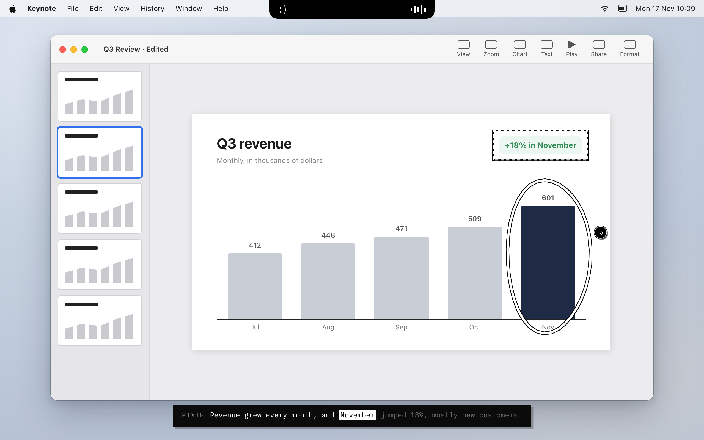
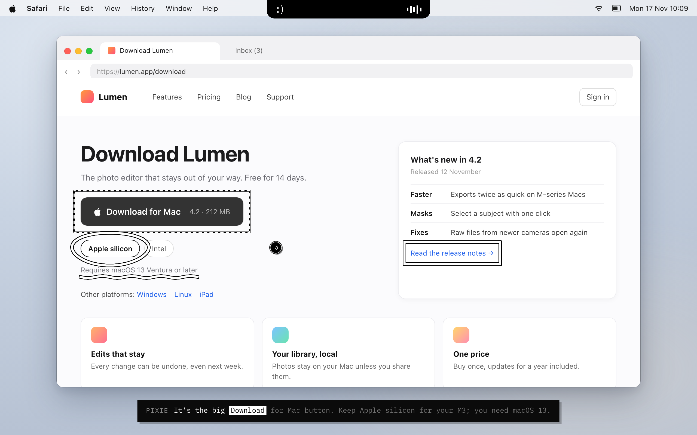
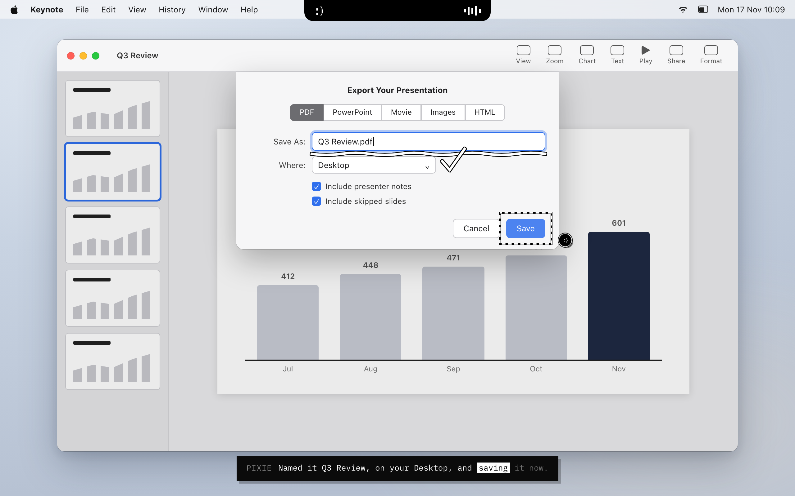
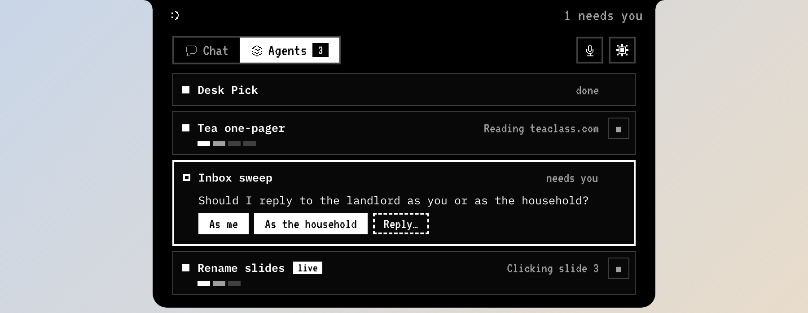
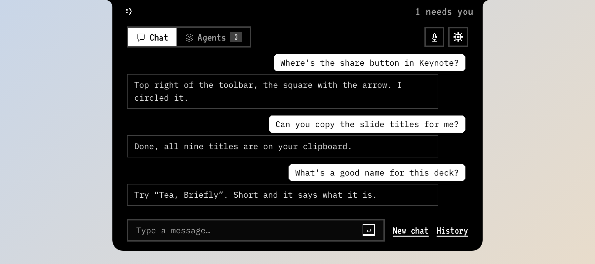
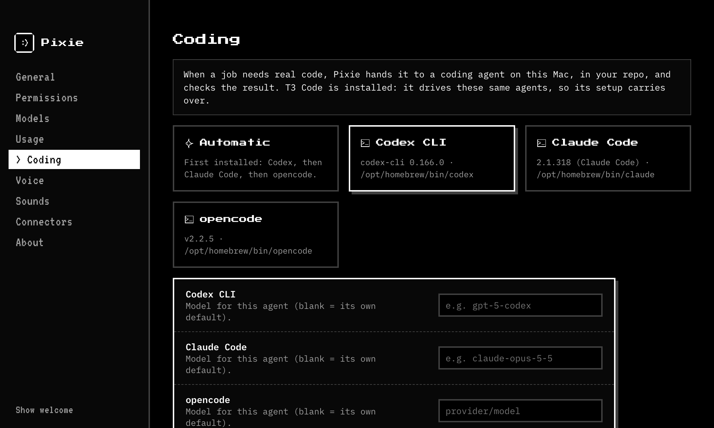
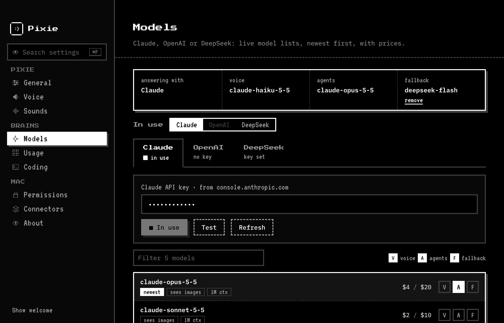
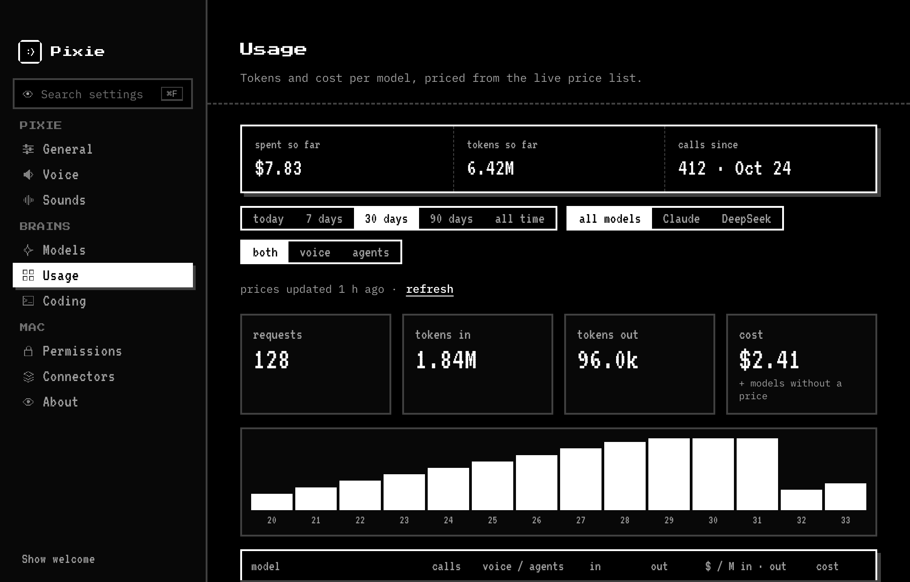

<p align="center">
  
</p>

<p align="center"><b>A little companion that lives in your Mac's notch.</b><br>
Hold <kbd>⌃ control</kbd> + <kbd>⌥ option</kbd> and talk: it hears you, sees your screen, answers out loud,<br>
points at things, draws to explain, clicks for you, and hands bigger work to agents.</p>

<p align="center">
  <a href="https://github.com/s41r4j/pixie/releases/latest"></a>
  <a href="https://github.com/s41r4j/pixie/actions/workflows/ci.yml"></a>
  
  <a href="LICENSE"></a>
</p>

<p align="center">
  <a href="https://github.com/s41r4j/pixie/releases/latest/download/Pixie-macOS-universal.dmg"><b>Download for Mac</b></a> ·
  <a href="https://pixie.s41r4j.in">Website</a> ·
  <a href="https://pixie.s41r4j.in/docs.html">Docs</a> ·
  <a href="CHANGELOG.md">Changelog</a> ·
  <a href="CHECKLIST.md">What works where</a>
</p>

<p align="center"></p>

## What it does

<table>
<tr>
<td width="50%" valign="top">

<h3>Talk, don't type</h3>
Hold the talk keys, ask, let go. Speech is recognised on your Mac and the answer is spoken back by a
natural voice that runs offline. The notch widens into two little ears while it listens and talks,
so nothing covers your work.
</td>
<td width="50%" valign="top">

<h3>It points and draws</h3>
A round <code>:)</code> buddy rides next to your pointer. It flies to the exact button it's talking
about and circles, boxes, underlines or arrows it, each mark appearing just as its words are
spoken. It works in browsers too: the buttons and links of the page you're on.
</td>
</tr>
<tr>
<td valign="top">

<h3>It does it for you</h3>
Say "do it" and Pixie clicks, types, uses menus and drags, reading the screen again after every
step. Before anything that deletes, sends or buys, it asks you in a dialog it can't answer itself,
and there's a pointer-only mode.
</td>
<td valign="top">

<h3>Agents for the long stuff</h3>
Background agents research, write and build on their own and keep a live note; live agents do the
task on your screen while explaining each step. Hover the notch to check on them.
</td>
</tr>
<tr>
<td valign="top">

<h3>One chat all day, and memory</h3>
Today's conversation waits in the notch, typed or spoken. Pixie keeps short notes about you on your
computer ("remember that my manager is Priya") that you can read, edit or delete.
</td>
<td valign="top">

<h3>Your coding agents</h3>
Code tasks go to the agent already on your Mac: Codex CLI, Claude Code or opencode, picking the one
with usage left. Pixie runs it headless and reads you the result.
</td>
</tr>
<tr>
<td valign="top">

<h3>Claude, OpenAI, DeepSeek, or free</h3>
Bring a key and pick from each provider's live model list, or skip the key: with opencode
installed, Pixie runs on its free models. Keys stay on your computer.
</td>
<td valign="top">

<h3>Know what it costs</h3>
Every call is counted on your computer and priced from the public price list, cached tokens
included. No telemetry: nothing leaves your Mac.
</td>
</tr>
</table>

**And more:**
- **Explains with drawings** on a real [Excalidraw](https://excalidraw.com) canvas you can edit, keep and export: org charts, mind maps, timelines, architecture, charts from your numbers, tables and wireframes, laid out for you. And (Experimental) in 3D models that move, come apart and cut open.
- **Four personalities**, each with its own face: Pix `:)`, Inos `8)`, Xtrem `XD` and Eon `;)`.
- **Set it up by asking**: "talk slower", "use the Emma voice", "switch to Eon", "make dictation a toggle".
- **Dictation anywhere, as you speak**: hold <kbd>fn</kbd> <kbd>⌃</kbd> and the words go into any field while you talk, with Pixie's own on-device speech to text (a one-time 73 MB download; English). Tidied when you stop.
- **Several screens and desktops**: it knows which screen you mean and keeps the notch where you want it.
- **Looks after itself**: restarts a part that hangs, keeps last-good copies of your settings, puts the last version back if an update won't start, and runs a checkup when you ask.
- **Updates itself** from GitHub: it downloads and checks the signature in the background, then shows what's new and asks before installing (now, when you quit, or skip that version).
- **Apps and the browser**: Calendar, Reminders, Contacts, Mail drafts (it never sends), Gmail and Google Calendar, your Chrome tabs, and connectors (MCP) for GitHub, Linear, Slack and more.

## Get started

1. **Download** [Pixie for Mac](https://github.com/s41r4j/pixie/releases/latest/download/Pixie-macOS-universal.dmg) (macOS 14+, Apple silicon and Intel), open the .dmg and drag Pixie to Applications. Windows and Linux previews are on the [releases page](https://github.com/s41r4j/pixie/releases/latest).
2. **Open it.** If macOS says it can't be opened: right-click → Open, or System Settings → Privacy & Security → Open Anyway.
3. **Follow the welcome window**: Microphone, Speech Recognition, Screen Recording and Accessibility, then a key for Claude, OpenAI or DeepSeek. No key? Install [opencode](https://opencode.ai) and pick Settings → Models → On this computer.
4. **Hold ⌃⌥ and ask** "what can you do?".

## Things to try

| Do this | What happens |
|---|---|
| Hold **⌃⌥**, talk, let go | The notch listens, thinks and answers out loud |
| "Where's the share button?" | The buddy flies to it and circles it |
| "Explain this toolbar" | A fuller explanation, pointing at each part as it's said |
| "Open System Settings, go to General → About" | Several steps in one go, checking the screen after each |
| "Draw how OAuth works" | An Excalidraw canvas with the diagram; edit it, keep it, export it |
| "Chart these numbers" / "Make a mind map of the launch" | A bar, line or pie chart, or a mind map, laid out on the canvas |
| "Show me how a heart pumps, in 3D" (Experimental) | A 3D model that turns to each part as Pixie names it |
| "Make me a one-page PDF about tea" | A background agent; hover the notch → Agents to watch its plan |
| "Remember that my manager is Priya" | A long-term note; "forget…" removes it |
| "Talk slower and use the Emma voice" | Changes its own settings at once |
| "Switch to Eon" | A calmer personality, and a new face in the notch |
| "Check yourself" / "Report this" | A checkup that fixes what it can, or a filled-in GitHub issue you submit |
| Tap **⌃⌥** (or click the menu bar `:)`) | A box to type instead of talk |
| Hold **fn⌃** and talk | Dictation into whatever field has focus |
| **esc** | Stops speech and the turn |
| "Quit" / "Stop working" / "New chat" | Quits / stops every job / starts a fresh chat, instantly |

More in the [docs](https://pixie.s41r4j.in/docs.html).

## Privacy

Speech recognition, screen reading (OCR) and the natural voice run on your computer. Screenshots
and your words go only to the model provider you chose, with your own key. Chats, memory notes,
canvases, usage and logs stay in Pixie's folder on your computer, and nothing is sent anywhere
else: no accounts, no telemetry. Problem reports open as a GitHub issue for you to read and submit.

## Platforms

| | Mac | Windows | Linux |
|---|---|---|---|
| Status | Everything | Preview | Preview |
| Download | universal .dmg | x64 installer | AppImage, .deb |

Per feature: [CHECKLIST.md](CHECKLIST.md).

## Build from source

Requirements: macOS 14+, Xcode command line tools, Rust stable and Node 20+.

```bash
git clone https://github.com/s41r4j/pixie && cd pixie
cp .env.example .env    # optional: a key for development, e.g. DEEPSEEK=sk-…
npm install
npm run app:build       # target/release/bundle/macos/Pixie.app (+ .dmg)
npm run app:install     # copy to /Applications and open
```

`npm run dev` runs it with hot reload. Signing, releases, keys, media, commands and the repo
layout are in [docs/DEVELOPMENT.md](docs/DEVELOPMENT.md); how it works inside is in
[docs/ARCHITECTURE.md](docs/ARCHITECTURE.md), and what's next in [docs/ROADMAP.md](docs/ROADMAP.md).
Built with Tauri 2, Rust, React and a small Swift helper.

## Credits

Pixie stands on open-source work. Thank you to:

- [Excalidraw](https://github.com/excalidraw/excalidraw) (MIT) for the canvas, and its
  [Mermaid](https://github.com/mermaid-js/mermaid) bridge for flowcharts
- [three.js](https://github.com/mrdoob/three.js) (MIT) for the 3D explanations
- [Tauri](https://github.com/tauri-apps/tauri) and [React](https://github.com/facebook/react) (MIT) for the app
- [sherpa-onnx](https://github.com/k2-fsa/sherpa-onnx) (Apache-2.0), the [Kokoro](https://huggingface.co/hexgrad/Kokoro-82M) voice (Apache-2.0) and the [streaming Zipformer](https://huggingface.co/csukuangfj/sherpa-onnx-streaming-zipformer-en-2023-06-26) speech model from k2-fsa's icefall (Apache-2.0), downloaded when you ask for the natural voice or Pixie's speech to text
- IBM Plex Mono, VT323, Press Start 2P and Patrick Hand (SIL Open Font License)

Every package Pixie ships with, and its licence: [THIRD_PARTY_NOTICES.md](THIRD_PARTY_NOTICES.md)
(also in the app: Settings → About → Open-source licences).

## Licence

[MIT](LICENSE). Bundled fonts are under the SIL Open Font License (`resources/fonts/OFL-*.txt`).
